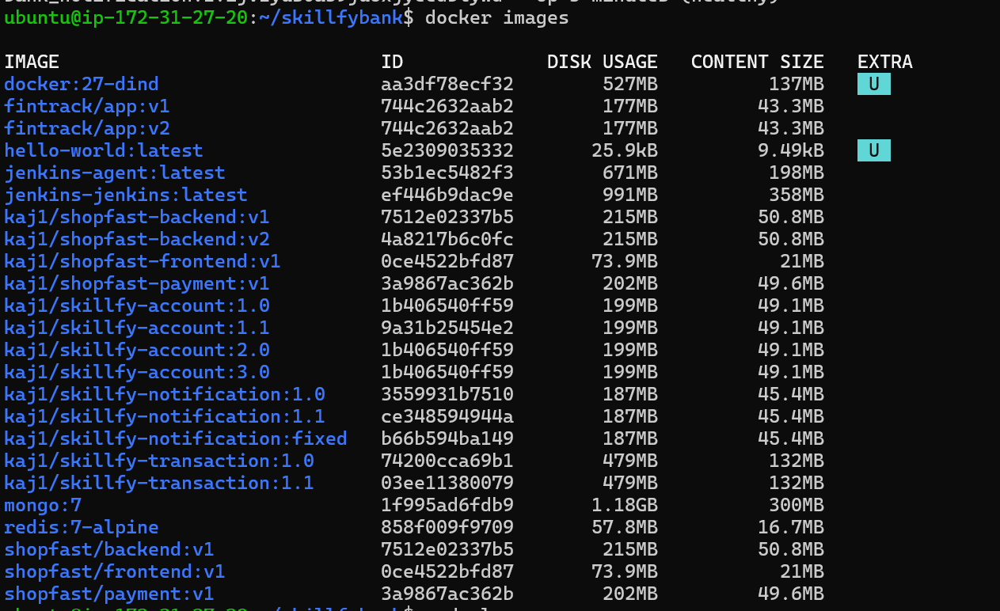
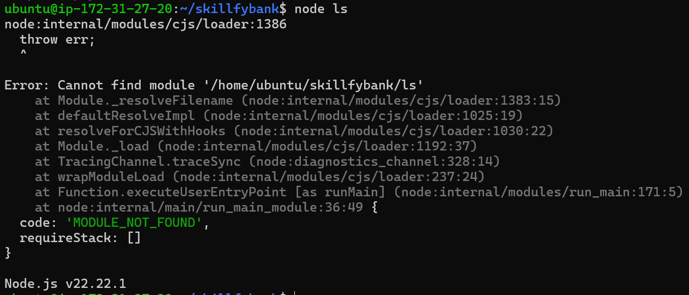

# SkillfyBank: Containerized Microservices with High Availability and Smart Traffic Routing

**Name:** Kankera Josephine
**Programme:** Skillfyme DevOps
**Assignment:** Docker Production-Level Assignment #1
**GitHub:** kajose01 | **Docker Hub:** kaj1

## 1. Problem statement
SkillfyBank needs three banking microservices (Account, Transaction, Notification)
containerized, run with high availability on Docker Swarm, migrated to Kubernetes,
and secured with intelligent traffic routing using Istio.

## 2. Solution approach
| Part | What was built | Status |
|------|----------------|--------|
| 1 | Dockerfiles with multi-stage builds, .dockerignore, layer caching; Docker network; images on Docker Hub; broken-push troubleshooting | done |
| 2 | Docker Swarm (3 managers + 2 workers), stack deploy, overlay network, rolling update, auto-restart, node-failure test, healthchecks | done |
| 3 | Kubernetes (3-node cluster), Deployments, ConfigMaps, Secrets, HPA, PV/PVC, Services, rollback, taints/tolerations | done |
| 4 | Istio: mTLS, 90/10 traffic split, canary, header-based A/B, Jaeger, circuit breaking | done |

Services: Account (Node.js, port 3000), Transaction (Spring Boot, port 8080, internal only),
Notification (Python Flask, port 5000).

## 3. Dependencies and setup
- Ubuntu server (AWS EC2 t3.large, 8 GB RAM)
- Docker Engine 27+, Docker Compose plugin
- A Docker Hub account (images: kaj1/skillfy-account, kaj1/skillfy-transaction, kaj1/skillfy-notification)
- Part 2: Docker-in-Docker containers simulate the five Swarm nodes
- Part 3 and 4: k3d, kubectl, istioctl

## 4. Execution steps
### Part 1

    docker build -t kaj1/skillfy-account:1.0 account
    docker build -t kaj1/skillfy-transaction:1.0 transaction
    docker build -t kaj1/skillfy-notification:1.0 notification
    docker network create skillfy-net
    docker run -d --name transaction --network skillfy-net kaj1/skillfy-transaction:1.0
    docker run -d --name account --network skillfy-net -p 3000:3000 kaj1/skillfy-account:1.0
    docker run -d --name notification --network skillfy-net -p 5000:5000 kaj1/skillfy-notification:1.0
    curl localhost:3000/accounts/transactions

### Part 2
See swarm/stack.yml. Deploy on a manager node with:

    docker stack deploy -c stack.yml bank

Parts 3 and 4 are in sections 6 and 7 below.

## 5. Evidence

Part 1: images built and pushed to Docker Hub (`docker images`).

Part 2: Swarm cluster with 3 managers and 2 workers (`docker node ls`).

Parts 3 and 4: the command outputs and test results are recorded in sections 6 and 7 below.

## 6. Part 3 execution steps (Kubernetes, 3-node k3d cluster)

    k3d cluster create skillfy --servers 1 --agents 2 --k3s-arg "--disable=traefik@server:*" -p "30080:30080@agent:0" -p "5000:5000@loadbalancer"
    kubectl create namespace skillfy
    kubectl create secret generic db-credentials --from-literal=DB_USER=bankuser --from-literal=DB_PASSWORD="$(openssl rand -base64 12)"
    kubectl label node k3d-skillfy-agent-1 workload=notification
    kubectl taint node k3d-skillfy-agent-1 dedicated=notification:NoSchedule
    kubectl apply -f k8s/00-config.yaml -f k8s/transaction.yaml -f k8s/account.yaml -f k8s/notification.yaml

k8s/secret.example.yaml is a placeholder only. The real Secret is created on the cluster and never committed.

Demonstrated: Deployments, ConfigMap, Secret, HPA (scaled 1 to 3 under load), PV and PVC (data survived pod deletion), ClusterIP, NodePort and LoadBalancer Services, a broken rollout (ImagePullBackOff) fixed with rollout undo, and taints and tolerations keeping Notification on a dedicated node.

## 7. Part 4 execution steps (Istio)

    istioctl install -y --set profile=minimal
    kubectl apply -f istio/telemetry.yaml
    kubectl label namespace skillfy istio-injection=enabled
    kubectl apply -f istio/transaction.yaml -f istio/notification.yaml
    kubectl apply -f istio/peer-auth.yaml
    kubectl apply -f istio/transaction-dr.yaml -f istio/transaction-vs.yaml
    kubectl apply -f istio/notification-dr.yaml -f istio/notification-vs-resilient.yaml
    kubectl apply -f istio/transaction-dr-cb.yaml

Demonstrated: STRICT mTLS (a pod outside the mesh is reset), a 90/10 split for Transaction (87/13 measured), an 80/20 canary for Notification (159/41 over 200 calls), header-based A/B routing (x-ab-test: B sends 100% to v2), Jaeger traces across client, account and transaction, retries (flaky endpoint: 18 of 40 succeeded before, 39 of 40 after), a 2 second timeout (slow endpoint: 200 after 3.0s before, 504 after 2.0s), and a circuit breaker (7 of 40 concurrent requests allowed, 33 shed).

Note: Istio profile "minimal" and an in-mesh client pod were used to fit the 8 GB server. The optional EFK bonus was not attempted.
